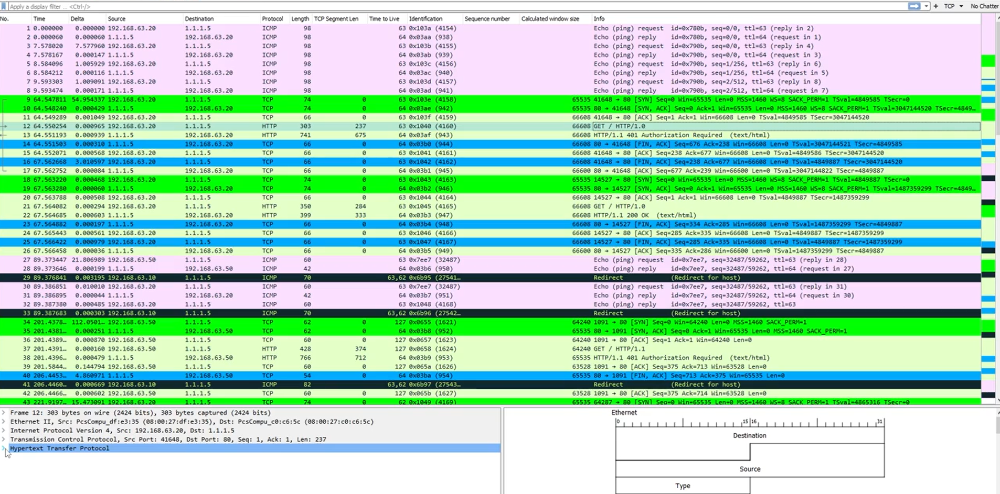
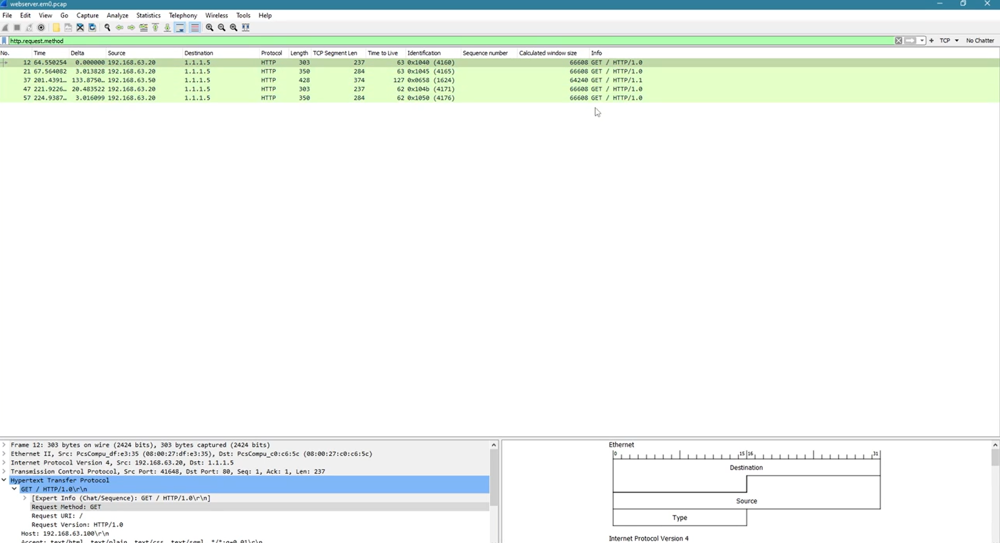
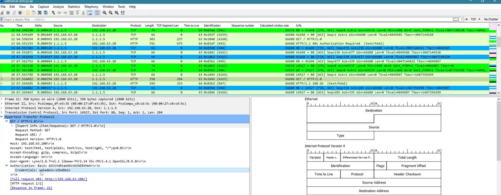

# Autenticación Básica HTTP

## Descripción General
Este proyecto documenta la investigación del tráfico de Autenticación Básica HTTP en un archivo de captura de paquetes.  
El objetivo fue analizar las solicitudes HTTP, identificar cómo se realizó la autenticación y determinar qué información confidencial se pudo recuperar del tráfico no cifrado.

## Escenario
La investigación se basó en un archivo PCAP que contiene la comunicación de red entre un cliente y un servidor web.  
Al revisar el flujo de paquetes en Wireshark, fue posible identificar las solicitudes HTTP, observar la secuencia de autenticación y recuperar las credenciales transmitidas a través de la Autenticación Básica HTTP.

## Objetivos
- Analizar el tráfico HTTP a nivel de paquetes en un archivo PCAP.
- Identificar las solicitudes y respuestas relacionadas con la autenticación.
- Comprender cómo funciona la Autenticación Básica HTTP en la práctica.
- Demostrar por qué la Autenticación Básica es insegura cuando se utiliza sin cifrado.

## Herramientas Utilizadas
- Wireshark
- Análisis de archivos PCAP
- Inspección de tráfico HTTP
- Revisión de encabezados HTTP
- Análisis de autenticación básica
- Conceptos de decodificación en Base64

## Pasos de la Investigación

### 1. Visión General del PCAP
Primero se revisó la captura de paquetes para comprender el flujo general de la comunicación e identificar la actividad de red relevante.  
Esto ayudó a establecer el contexto antes de limitar el análisis al tráfico HTTP.

### 2. Filtrado de Solicitudes HTTP
Luego se filtró el tráfico para aislar las solicitudes HTTP y enfocarse en la comunicación web entre el cliente y el servidor.  
Esto facilitó la identificación de solicitudes `GET` repetidas y el examen del flujo de autenticación de manera estructurada.

### 3. Análisis de Autenticación
El intercambio HTTP mostró una respuesta `401 Authorization Required` seguida de una solicitud autenticada que contenía un encabezado `Authorization: Basic`.  
La inspección de los detalles HTTP reveló las credenciales transmitidas, demostrando que el nombre de usuario y la contraseña se podían recuperar directamente desde el tráfico.

## Hallazgos Clave
- Las credenciales de Autenticación Básica HTTP pueden quedar expuestas en formato recuperable cuando se utiliza HTTP sin cifrado.
- Las capturas de paquetes pueden revelar tanto el flujo de autenticación como las credenciales transmitidas.
- Revisar los encabezados HTTP es esencial al investigar mecanismos de autenticación inseguros.
- Incluso el tráfico de autenticación web simple puede proporcionar evidencia valiosa durante una investigación.

## Resultado
Este proyecto reforzó mi capacidad para inspeccionar capturas de paquetes, analizar el comportamiento de la autenticación HTTP e identificar la transmisión insegura de credenciales en el tráfico de red.  
También reafirmó la importancia de los protocolos de transporte cifrados para proteger los datos de autenticación.

## Habilidades Demostradas
- Análisis de PCAP
- Análisis de tráfico HTTP
- Investigación del flujo de autenticación
- Análisis de Autenticación Básica HTTP
- Identificación de exposición de credenciales
- Documentación técnica
